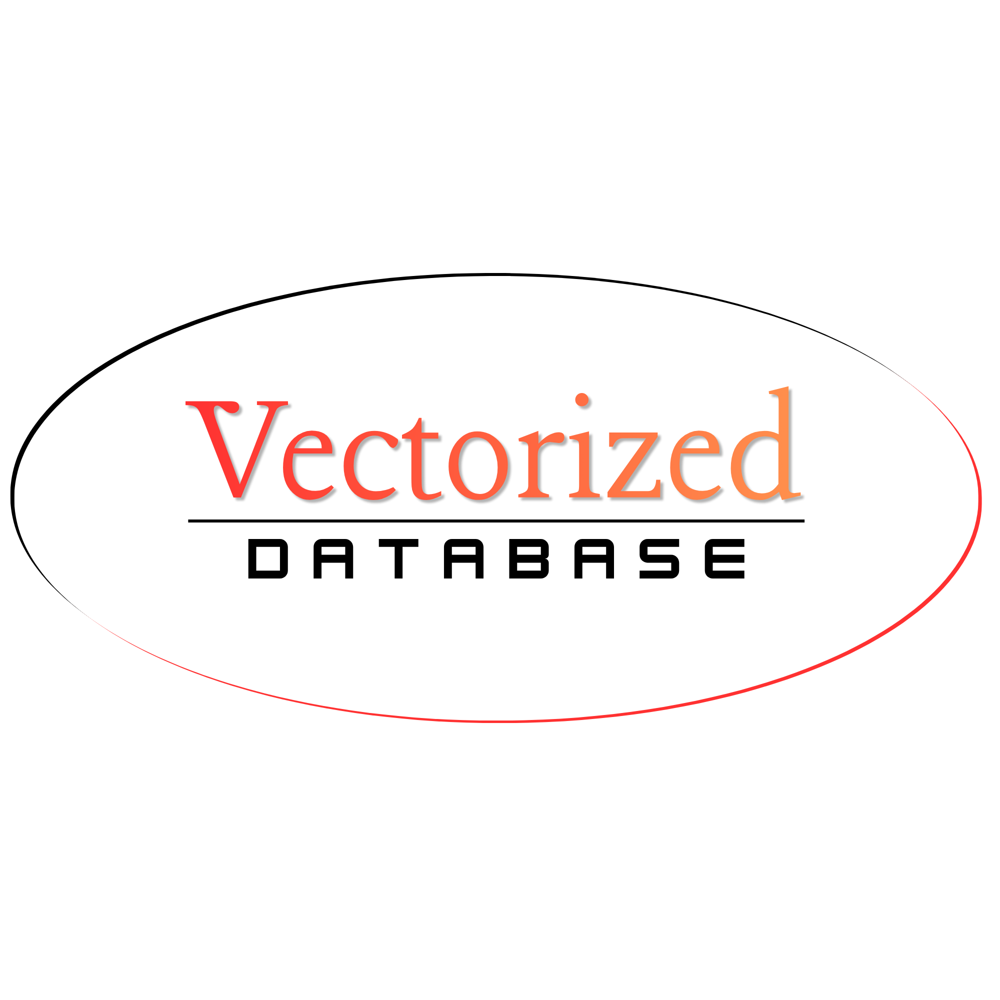

# VectorizedDB
A lightweight, custom-built vector database written in Python. This side project stores mathematical representations of text (vectors) to power similarity search and keyword comparison.

## Getting started

Requires Python 3.10 or newer.

```bash
git clone https://github.com/elh0mbr3/vectorized-db.git
cd vectorized-db
pip install .
vectordb-ui
```

Then open http://127.0.0.1:8000 in your browser.

On the first run, a few sample documents are loaded so you can try searching right away.
Your data is saved in a `.vectorized_db` folder in your home directory.
